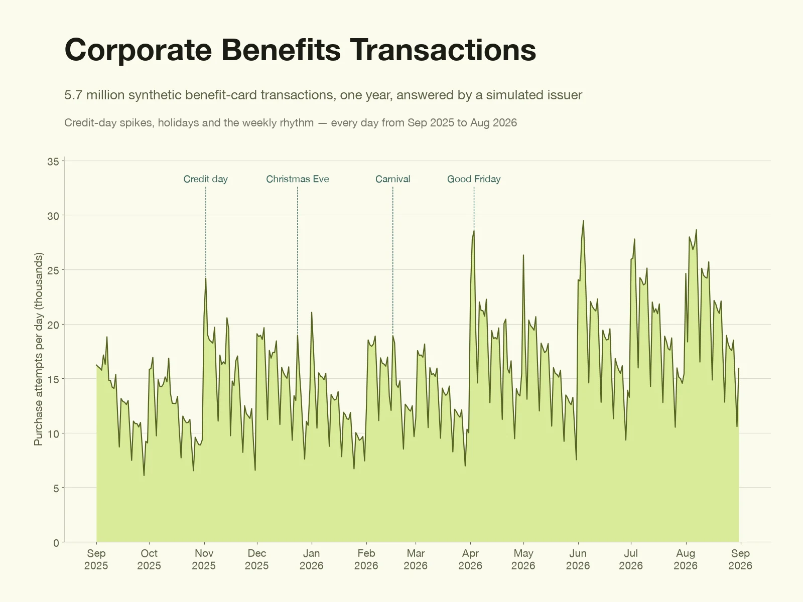
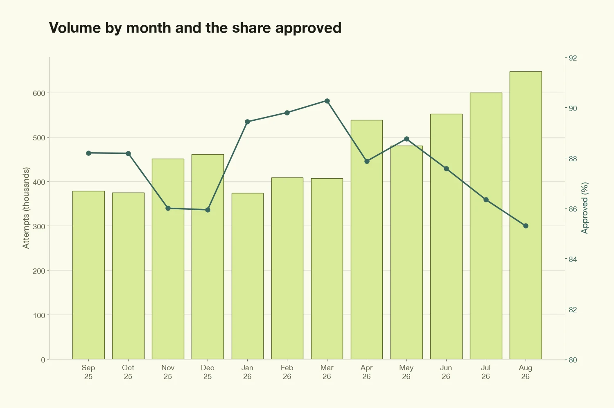
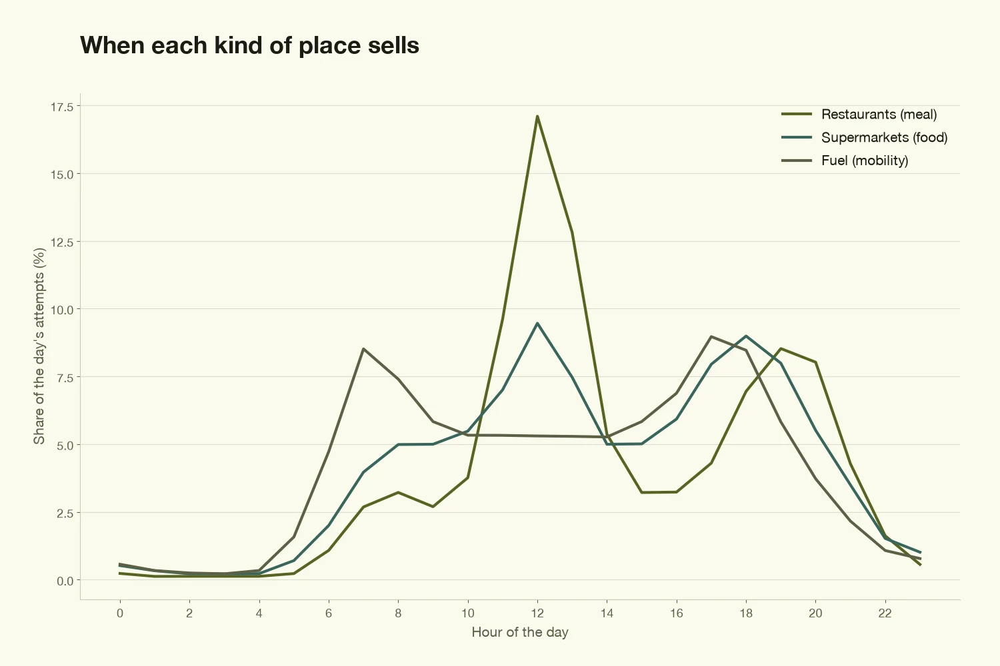
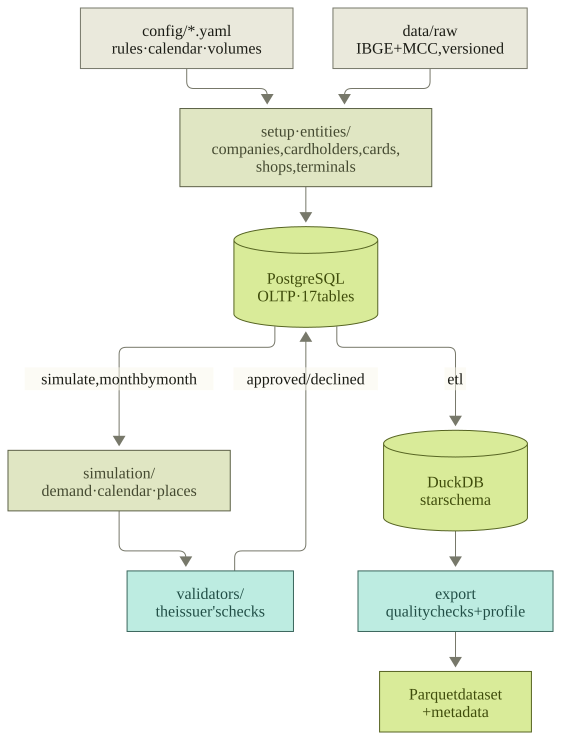

<a id="readme-top"></a>

<!-- PROJECT SHIELDS -->
[![CI][ci-shield]][ci-url]
[![MIT License][license-shield]][license-url]
[![Python][python-shield]][python-url]
[![Last commit][commit-shield]][commit-url]

<!-- PROJECT LOGO -->
<br />
<div align="center">
  <a href="https://github.com/Nic-Soares/corporate-benefits-transactions">
    
  </a>

  <h3 align="center">Corporate Benefits Transactions</h3>

  <p align="center">
    A synthetic dataset of Brazilian benefit-card transactions, answered by a simulated issuer the way the market does.
    <br />
    <a href="docs/technical-architecture.md"><strong>Explore the docs »</strong></a>
    <br />
    <br />
    <a href="docs/data-dictionary.md">Data dictionary</a>
    &middot;
    <a href="https://github.com/Nic-Soares/corporate-benefits-transactions/issues/new?labels=bug">Report Bug</a>
    &middot;
    <a href="https://github.com/Nic-Soares/corporate-benefits-transactions/issues/new?labels=enhancement">Request Feature</a>
  </p>
</div>


<!-- TABLE OF CONTENTS -->
<details>
  <summary>Table of Contents</summary>
  <ol>
    <li>
      <a href="#about-the-project">About The Project</a>
      <ul>
        <li><a href="#the-market-it-models">The market it models</a></li>
        <li><a href="#whats-in-the-dataset">What's in the dataset</a></li>
        <li><a href="#built-with">Built With</a></li>
      </ul>
    </li>
    <li>
      <a href="#getting-started">Getting Started</a>
      <ul>
        <li><a href="#prerequisites">Prerequisites</a></li>
        <li><a href="#installation">Installation</a></li>
      </ul>
    </li>
    <li><a href="#usage">Usage</a></li>
    <li><a href="#architecture">Architecture</a></li>
    <li><a href="#data-sources">Data sources</a></li>
    <li><a href="#roadmap">Roadmap</a></li>
    <li><a href="#contributing">Contributing</a></li>
    <li><a href="#license">License</a></li>
    <li><a href="#contact">Contact</a></li>
    <li><a href="#acknowledgments">Acknowledgments</a></li>
  </ol>
</details>


<!-- ABOUT THE PROJECT -->
## About The Project

A public, synthetic dataset of Brazilian corporate benefit-card transactions — meal, food, mobility, multi-benefit and incentive cards. No row is real, but every row went through what a real one goes through: an issuer that checks the card, the cardholder, the shop, the terminal, the PIN, which wallet the shop accepts and whether there is balance, then approves or declines with an ISO 8583 response code and a specific reason.

The aim is a dataset that **behaves like the market** — relationships that hold, distributions that look right, business rules followed everywhere — for testing dashboards, metrics and data pipelines at volume. Not a pile of random rows.

* **Simulated, not sampled:** approvals and declines come out of the rules applied in time order, so rates, reasons and balances agree with each other.
* **Shaped like the market:** spending follows each wallet's monthly credit; lunch and evening peaks; holidays, Christmas Eve and Black Friday; months that vary with no drift (85–90% approved).
* **Checked before it ships:** the export refuses to write a dataset that breaks a key, the balance ledger or the statistical profile.
* **Reproducible:** the same seed gives the same dataset anywhere; `dataset_metadata.json` records seed, window, code commit and the hashes of the config and the sources.

<p align="right">(<a href="#readme-top">back to top</a>)</p>

### The market it models

Employers give employees cards whose balances can only be spent on certain things. A card belongs to a **program**, and the program fixes the **wallets** (*carteiras*) the card holds — one balance each — and the network it runs on:

| Program | Wallets | Network |
|---|---|---|
| Alimentação | Food | Proprietary |
| Refeição | Meal | Proprietary |
| Multibenefícios (rede própria) | Food, Meal, Mobility, Health, Home office, Education, Gift | Proprietary |
| Multibenefícios (bandeirado) | Same seven wallets | Visa, Mastercard or Elo |
| Presente / Premiação | Gift / Premium | Proprietary |
| Combustível | Mobility | Proprietary |

* **The issuer's proprietary network** (`OWN`, 3-party): the cardholder picks *Food*, *Meal* or *Others* on the terminal, and the establishment's **CNAE** (Brazil's economic activity code) must accept the wallet — the most specific code prefix with a rule decides.
* **Brand networks** (Visa, Mastercard, Elo — 4-party: acquirer → brand → issuer): the brand must accept the establishment's **MCC**, and the issuer picks the wallet from it (meal first, then food, the other wallets, gift last). Brand cards can withdraw cash from the gift wallet.

Every decline carries an ISO 8583 code and a reason (wrong PIN, wallet not accepted here, insufficient balance…). An approved purchase spends the wallet, and the benefit is credited again each month. Details: [`docs/business-rule.md`](docs/business-rule.md).

<p align="right">(<a href="#readme-top">back to top</a>)</p>

### What's in the dataset

The official build (seed 42, Sep 2025 – Aug 2026, scale 4):

| | |
|---|---|
| Purchase attempts | **5.7 million**, with the issuer's answer and decline reason |
| Balance movements | **5.6 million** credits, debits and reversals, chained |
| World | 800 companies · 34 thousand cardholders · 8 thousand establishments · 12 thousand terminals, in real IBGE municipalities |
| Fraud | labelled by scenario (account takeover, card not present, intercepted card, skimming), plus disputes including friendly fraud — [`docs/fraud-scenarios.md`](docs/fraud-scenarios.md) |
| Tables | 10 dimensions, 2 facts, 5 reference tables (the rules behind each decline) as Parquet, with a [data dictionary](docs/data-dictionary.md), a quality report and the run metadata |

No CPF, CNPJ, card number or person name: the ids identify.

<div align="center">
  
  
</div>

<p align="right">(<a href="#readme-top">back to top</a>)</p>

### Built With

* [![Python][python-badge]][python-url]
* [![Polars][polars-badge]][polars-url]
* [![PostgreSQL][postgres-badge]][postgres-url]
* [![DuckDB][duckdb-badge]][duckdb-url]
* [![Apache Parquet][parquet-badge]][parquet-url]
* [![Docker][docker-badge]][docker-url]
* [![uv][uv-badge]][uv-url]

<p align="right">(<a href="#readme-top">back to top</a>)</p>


<!-- GETTING STARTED -->
## Getting Started

### Prerequisites

* [uv](https://docs.astral.sh/uv/) — it installs Python 3.14 when missing
  ```sh
  brew install uv
  ```
* Docker with Compose (Docker Desktop, OrbStack, Colima…) and `make`

### Installation

1. Clone the repo
   ```sh
   git clone https://github.com/Nic-Soares/corporate-benefits-transactions.git
   cd corporate-benefits-transactions
   ```
2. Install the dependencies and run the offline checks
   ```sh
   make install
   make check
   ```
3. Start PostgreSQL (local defaults; copy `.env.example` to `.env` only to change them)
   ```sh
   make db
   ```

<p align="right">(<a href="#readme-top">back to top</a>)</p>


<!-- USAGE -->
## Usage

Build the dataset — `setup → simulate → etl → export`:

```sh
make dataset                 # a year at scale 1: about 2.5 million transactions, 4 minutes
make dataset SCALE=4         # the official size: about 5.7 million, 7 minutes, 3 GB of memory
make dataset DAYS=90 TODAY=2026-10-30 SEED=7
make help                    # every target
```

The window is the `DAYS` before `TODAY`. The output lands in `data/dataset/` (Parquet, `data_dictionary.md`, `quality_report.md`, `dataset_metadata.json`) and the analytical database in `data/olap/olap_corporate_benefits.duckdb`:

```sql
-- DuckDB: approval and the main decline reason, month by month
SELECT strftime(date, '%Y-%m') AS month,
       count(*) AS attempts,
       round(avg((response_code = '00')::INT), 3) AS approved,
       mode(decline_reason) AS top_decline
FROM fact_transactions
GROUP BY 1 ORDER BY 1;
```

The commands also run one by one with `uv run benefits setup | simulate | etl | export`; a variant of the rules runs with `uv run benefits --config DIR …`. Step by step, with troubleshooting: [`docs/runbooks/local-setup.md`](docs/runbooks/local-setup.md).

<p align="right">(<a href="#readme-top">back to top</a>)</p>


<!-- ARCHITECTURE -->
## Architecture

<div align="center">
  
</div>

* **`setup`** generates the world — companies, cardholders, cards and wallets, establishments, terminals — into PostgreSQL, the OLTP model and column contract.
* **`simulate`** plans every purchase attempt (who buys follows the credit, when follows the calendar, where follows the shops near home that take the wallet), then month by month lets the issuer answer them in time order: balances move, limits count, reversals arrive later. Memory follows a month, not the window.
* **`etl`** loads a DuckDB star schema with plain SQL; **`export`** runs the quality checks and the statistical profile, and only then writes Parquet.

```
config/          reference.yaml · authorization.yaml · simulation.yaml · database.yaml
data/            raw/ (public sources, versioned) · olap/ · dataset/ (generated)
database/        model/ (DBML) · oltp/ (PostgreSQL schema) · olap/ (star schema, load SQL, dictionary)
src/
├── main.py      command line          ├── entities/    the world's generators, seeded fake data
├── config.py    YAML, read once       ├── domain/      rules both sides share: acceptance, status
├── postgres.py  COPY, bulk loads      ├── simulation/  demand, calendar, pools, attempts, fraud, issuer
├── reference.py reference tables      ├── validators/  the issuer's authorization checks
├── table.py     indexed rows          └── pipeline/    the commands, provenance, statistical profile
└── sources/     IBGE and MCC downloads
```

More in [`docs/technical-architecture.md`](docs/technical-architecture.md) and the decision records in [`docs/adr/`](docs/adr/).

<p align="right">(<a href="#readme-top">back to top</a>)</p>


<!-- DATA SOURCES -->
## Data sources

Every record is synthetic. The generators draw on public reference data, versioned in `data/raw/`:

| Data | Source | Used for |
|---|---|---|
| CNAE 2.3 classes and subclasses | [IBGE CNAE API](https://servicodados.ibge.gov.br/api/docs/cnae) (CONCLA), official | Establishment activities, CNAE rule descriptions |
| Municipalities | [IBGE localities API](https://servicodados.ibge.gov.br/api/docs/localidades), official | Where companies, cardholders and establishments are |
| Population estimates | [IBGE aggregates API](https://servicodados.ibge.gov.br/api/docs/agregados), table 6579, official | Cardholders and establishments where people live |
| Municipal GDP | [IBGE aggregates API](https://servicodados.ibge.gov.br/api/docs/agregados), table 5938, official | Companies where the economy is |
| Merchant Category Codes | [greggles/mcc-codes](https://github.com/greggles/mcc-codes) (Unlicense), compiled from the card brands' public manuals | MCC codes and descriptions |

**Synthetic by design:** which brand accepts each MCC, which wallet each CNAE and MCC takes, the CNAE → MCC mapping, and every weight, balance, limit and ticket in `config/`. They follow how the Brazilian benefits market works, not any company's data.

<p align="right">(<a href="#readme-top">back to top</a>)</p>


<!-- ROADMAP -->
## Roadmap

- [x] Toolchain, tests and CI; the existing code cleaned up and documented (EP-01 – EP-05)
- [x] Transaction core after how benefits issuers work: programs, wallets, two networks (EP-06)
- [x] Setup pipeline and the transaction simulator, fraud included (EP-07, EP-08)
- [x] DuckDB star schema and the checked Parquet export (EP-09, EP-10)
- [x] Architecture review: reproducible, one acceptance rule, volume, statistical profile (EP-12)
- [x] Flat layout, config by purpose, `make` (EP-13)
- [ ] Kaggle release: dataset page and an example notebook (EP-11)

See the [roadmap](docs/planning/ROADMAP.md) for every story.

<p align="right">(<a href="#readme-top">back to top</a>)</p>


<!-- CONTRIBUTING -->
## Contributing

Suggestions and fixes are welcome.

1. Fork the project
2. Create a branch from `develop`: `<type>/st-XX.Y-<slug>` (`feat`, `fix`, `docs`, `refactor`…)
3. Commit with [Conventional Commits](https://www.conventionalcommits.org/) (`feat(simulation): …`)
4. Run `make check` (and `make test-db` when touching the database)
5. Open a pull request to `develop`

`main` holds released code; `develop` integrates every story with a `merge(<scope>): …` commit. Dependencies: [`docs/runbooks/dependency-upgrades.md`](docs/runbooks/dependency-upgrades.md).

<p align="right">(<a href="#readme-top">back to top</a>)</p>


<!-- LICENSE -->
## License

Distributed under the MIT License. See [`LICENSE`](LICENSE) for more information.

<p align="right">(<a href="#readme-top">back to top</a>)</p>


<!-- CONTACT -->
## Contact

Nicolas Santos — [github.com/Nic-Soares](https://github.com/Nic-Soares)

Project link: [github.com/Nic-Soares/corporate-benefits-transactions](https://github.com/Nic-Soares/corporate-benefits-transactions)

<p align="right">(<a href="#readme-top">back to top</a>)</p>


<!-- ACKNOWLEDGMENTS -->
## Acknowledgments

* [IBGE](https://www.ibge.gov.br/) — open APIs for CNAE, municipalities, population and GDP
* [greggles/mcc-codes](https://github.com/greggles/mcc-codes) — the public MCC list
* [mimesis](https://mimesis.name/) — localized fake data
* [Best-README-Template](https://github.com/othneildrew/Best-README-Template) — this README's layout
* [Shields.io](https://shields.io/) — badges

<p align="right">(<a href="#readme-top">back to top</a>)</p>


<!-- MARKDOWN LINKS & IMAGES -->
[ci-shield]: https://img.shields.io/github/actions/workflow/status/Nic-Soares/corporate-benefits-transactions/ci.yml?branch=main&style=for-the-badge&label=CI
[ci-url]: https://github.com/Nic-Soares/corporate-benefits-transactions/actions/workflows/ci.yml
[license-shield]: https://img.shields.io/github/license/Nic-Soares/corporate-benefits-transactions.svg?style=for-the-badge
[license-url]: https://github.com/Nic-Soares/corporate-benefits-transactions/blob/main/LICENSE
[python-shield]: https://img.shields.io/badge/python-3.14-3776AB?style=for-the-badge&logo=python&logoColor=white
[commit-shield]: https://img.shields.io/github/last-commit/Nic-Soares/corporate-benefits-transactions.svg?style=for-the-badge
[commit-url]: https://github.com/Nic-Soares/corporate-benefits-transactions/commits/main
[python-badge]: https://img.shields.io/badge/Python-3776AB?style=for-the-badge&logo=python&logoColor=white
[python-url]: https://www.python.org/
[polars-badge]: https://img.shields.io/badge/Polars-CD792C?style=for-the-badge&logo=polars&logoColor=white
[polars-url]: https://pola.rs/
[postgres-badge]: https://img.shields.io/badge/PostgreSQL-4169E1?style=for-the-badge&logo=postgresql&logoColor=white
[postgres-url]: https://www.postgresql.org/
[duckdb-badge]: https://img.shields.io/badge/DuckDB-FFF000?style=for-the-badge&logo=duckdb&logoColor=black
[duckdb-url]: https://duckdb.org/
[parquet-badge]: https://img.shields.io/badge/Apache%20Parquet-50ABF1?style=for-the-badge&logo=apacheparquet&logoColor=white
[parquet-url]: https://parquet.apache.org/
[docker-badge]: https://img.shields.io/badge/Docker-2496ED?style=for-the-badge&logo=docker&logoColor=white
[docker-url]: https://www.docker.com/
[uv-badge]: https://img.shields.io/badge/uv-DE5FE9?style=for-the-badge&logo=uv&logoColor=white
[uv-url]: https://docs.astral.sh/uv/
