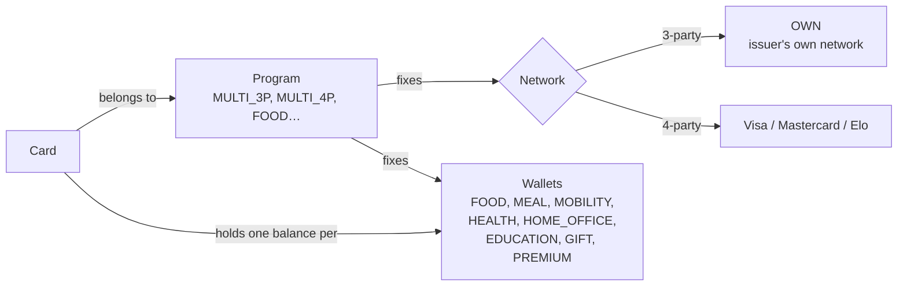
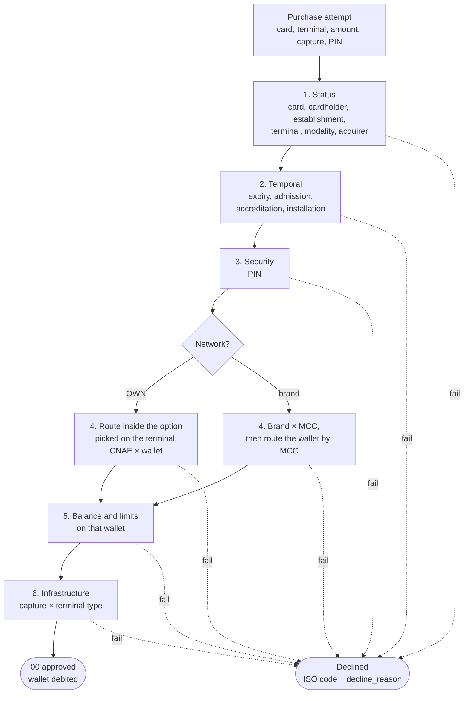

# Business Rules

How a transaction is authorized. The rules live in `config/`; this page explains them. Response codes follow ISO 8583 (`config/pre_populated_data.yaml → response_codes`); every decline also records a specific `decline_reason`.

## Programs and wallets

A card belongs to a **program**. The program fixes which **wallets** (*carteiras*) the card holds and which **network** it runs on. Each wallet has its own balance and limits.

| Program | Name | Network | Wallets |
|---|---|---|---|
| `FOOD` | Alimentação | Proprietary (3-party) | FOOD |
| `MEAL` | Refeição | Proprietary (3-party) | MEAL |
| `MULTI_3P` | Multibenefícios (rede própria) | Proprietary (3-party) | FOOD, MEAL, MOBILITY, HEALTH, HOME_OFFICE, EDUCATION, GIFT |
| `MULTI_4P` | Multibenefícios (bandeirado) | Brand (4-party): Visa, Mastercard or Elo | FOOD, MEAL, MOBILITY, HEALTH, HOME_OFFICE, EDUCATION, GIFT |
| `GIFT` | Presente | Proprietary (3-party) | GIFT |
| `PREMIUM` | Premiação | Proprietary (3-party) | PREMIUM |
| `FUEL` | Combustível | Proprietary (3-party) | MOBILITY |

Source: `config/pre_populated_data.yaml → wallets`, `card_programs`.

## The two networks

| | Proprietary network (`OWN`, 3-party) | Brand network (Visa, Mastercard, Elo — 4-party) |
|---|---|---|
| Chain | Terminal → issuer | Terminal → acquirer → brand → issuer |
| Who picks the wallet | The cardholder picks an option on the terminal (*Food*, *Meal* or *Others*); the issuer routes inside it | The issuer, from the establishment's **MCC** |
| What authorizes the place | The establishment's **CNAE** accepts that wallet | The brand accepts the MCC |
| Rule data | `cnae_wallets` | `mcc_modalities` (MCC × brand) + `mcc_wallets` (MCC × wallet) |

### Options and CNAE rule (proprietary network)

The terminal offers three options (`validation_rules.yaml → wallet_routing.proprietary_options`):

| Option | Wallets, in routing order |
|---|---|
| `FOOD` | FOOD |
| `MEAL` | MEAL |
| `OTHERS` | MOBILITY → HEALTH → HOME_OFFICE → EDUCATION → GIFT → PREMIUM |

The issuer takes the first wallet of the option that the card holds, is active, is accepted at the establishment's CNAE and has the balance. `cnae_wallets` lists CNAE prefixes at several levels; **the longest prefix of the establishment's CNAE decides** (its active rules), so a subclass entry replaces its class's list. Example: `5611` (restaurants and bars) accepts MEAL and GIFT, but `5611201` (restaurants) lists only MEAL, so *Others* is declined at a `5611201` restaurant.

- The card holds no wallet of the option → `57`, `wallet_not_on_card`
- None of them active → `57`, `card_wallet_inactive`
- None accepted at the CNAE → `57`, `wallet_not_accepted_at_cnae`
- None with enough balance → `51`, `insufficient_balance`

### MCC rules (brand network)

1. The brand must accept the MCC (`validation_rules.yaml → mcc_acceptance_rules`, `E` Elo, `M` Mastercard, `V` Visa). Otherwise `57`, `mcc_not_accepted_by_brand`.
2. The issuer **routes the wallet**: it walks `wallet_priority` (MEAL → FOOD → MOBILITY → HEALTH → HOME_OFFICE → EDUCATION → GIFT) and takes the first wallet that the card holds, is active, accepts the MCC (`mcc_wallets`; GIFT accepts any MCC) and has enough balance. The declines are those of the proprietary network, with `no_wallet_for_mcc` when no wallet accepts the MCC.

### Cash withdrawal

Brand cards withdraw at cash machines (MCC `6011`) from the GIFT wallet only (`withdrawal_wallets`); a proprietary-network card can't (`57`, `withdrawal_not_allowed`).

Example: a Visa multi-benefit card at a restaurant (MCC `5812`) with MEAL 20.00 and GIFT 1,000.00 buys 50.00 → MEAL can't pay, FOOD doesn't take `5812`, GIFT pays.

## Authorization

`config/validation_rules.yaml → validation_order`; the first failure declines.

| Group | Check | ISO code | `decline_reason` |
|---|---|---|---|
| Status | Card inactive / blocked / cancelled | `78` / `62` / `46` | `card_inactive`, `card_blocked`, `card_cancelled` |
| | Cardholder inactive or terminated | `62` | `cardholder_inactive`, `cardholder_terminated` |
| | Establishment not active | `03` | `establishment_<status>` |
| | Terminal inactive or in maintenance | `58` | `terminal_<status>` |
| | Modality disabled / acquirer disabled | `57` / `58` | `modality_disabled` / `acquirer_disabled` |
| Temporal | Card expired | `54` | `card_expired` |
| | Before the cardholder's admission | `62` | `before_admission` |
| | Before accreditation / installation | `03` / `58` | `before_accreditation` / `before_installation` |
| Security | Wrong PIN (chip and stripe ask for it) | `55` | `wrong_pin` |
| Business rules | See the networks above: no wallet on the card, inactive, not accepted here, no withdrawal | `57`, `51` | `wallet_not_on_card`, `card_wallet_inactive`, `wallet_not_accepted_at_cnae`, `no_wallet_for_mcc`, `mcc_not_accepted_by_brand`, `withdrawal_not_allowed` |
| Balance and limits | Balance below the amount | `51` | `insufficient_balance` |
| | Daily / monthly limit (0 = no limit) | `61` | `daily_limit_exceeded`, `monthly_limit_exceeded` |
| | Purchases per day on the wallet (Food and Meal) | `65` | `daily_count_exceeded` |
| Infrastructure | The terminal doesn't take the capture: TEF only chip and stripe, e-commerce only online, ATM only chip | `58` | `capture_not_supported` |

A referenced record that doesn't exist declines with the ISO code for that party (`14` card or cardholder, `57` wallet not on the card, `15` modality, `03` establishment, `58` terminal, `92` acquirer) and `<entity>_not_found`. A status missing from a rule's list declines with `96`.

## Balance

Each card wallet has a **monthly credit** (`card_wallets.monthly_credit`, drawn from `simulation_config.yaml → generation_settings.wallets`) and starts the simulation with a share of it. On the credit day (`benefit_credit_day`) the credit lands (`balance.credit`, `balance_history.operation_type = credit`); an approved purchase debits the charged wallet (`balance.debit`, `purchase`). Spending follows the credit — more early in the month, more `51` declines late. How the employer orders and pays the credit is out of scope.

Limits per wallet are in the same section: Meal has the lowest daily amount; Food and Meal cap the purchases per day; the other wallets have none.

## Statuses

Valid statuses per entity are in `config/business_rules.yaml → status_options`; the generators draw them with the weights in `config/simulation_config.yaml → generation_settings`.

| Entity | Statuses |
|---|---|
| Card | `active`, `inactive`, `blocked`, `cancelled` |
| Card wallet | `active`, `suspended`, `cancelled` |
| Cardholder | `active`, `inactive`, `terminated` |
| Establishment | `active`, `inactive`, `suspended`, `terminated` |
| Terminal | `active`, `inactive`, `maintenance` |

## Out of scope

Fees and establishment payments (MDR, reimbursement, settlement), the employer side (credit orders, credit expiry) and wallet-to-wallet transfers.
