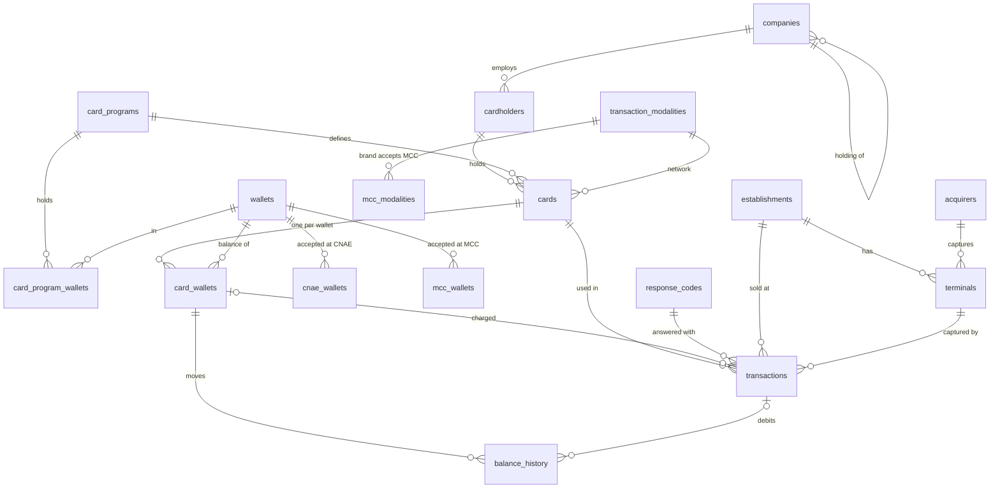

# Data Strategy

Where each table's data comes from. Table and column names are those of `database/oltp_postgres/oltp_schema.sql` ([ADR-006](adr/006-oltp-schema-as-column-contract.md)); the model is explained in [ADR-007](adr/007-transaction-core-model.md) and [ADR-008](adr/008-transaction-record.md).

## Model



## Reference tables — from the config

| Table | Source | Rows |
|---|---|---|
| `wallets` | `pre_populated_data.yaml → wallets` | 8 |
| `card_programs` | `pre_populated_data.yaml → card_programs` | 7 |
| `card_program_wallets` | each program's `wallets` | one row per program × wallet |
| `transaction_modalities` | `pre_populated_data.yaml → transaction_modalities` | 4 (OWN, VISA, MASTERCARD, ELO) |
| `acquirers` | `pre_populated_data.yaml → acquirers` | 7 (six acquirers and the ATM network) |
| `response_codes` | `pre_populated_data.yaml → response_codes` | 16 ISO 8583 codes |
| `cnae_wallets` | `pre_populated_data.yaml → cnae_wallets` | one row per CNAE prefix × wallet |
| `mcc_wallets` | `pre_populated_data.yaml → mcc_wallets` | one row per MCC × wallet (GIFT takes any MCC, no rows) |
| `mcc_modalities` | `validation_rules.yaml → mcc_acceptance_rules` × the public MCC list | one row per MCC × accepting brand |

Loaders: `src/data_generators/reference_data/`. External sources (`src/extractors/`, listed in the README): the IBGE CNAE, localities and population APIs, and the public MCC list. `mcc_acceptance_rules` is synthetic: the brands don't publish their acceptance tables.

## Entity tables — generated

Generated in batches, parents first, by `src/data_generators/entities/`:

```
companies (holdings, then branches)   segment by weight; a branch keeps its holding's
  └── cardholders            as many as the segment says; admission ≥ company registration
        └── cards            one per program of the company's bundle; network from the program
              └── card_wallets   every wallet of the program; monthly credit, balance, limits
establishments               category by weight → a CNAE of it → the MCC of that CNAE
  └── terminals              POS/TEF by acquirer weight, e-commerce gateway or ATM by category
```

- Segments and sizes: `simulation_config.yaml → generation_settings.company_segments` — SME 1–250 employees, Middle 251–1,999, Corporate 2,000+, Public by kind of client; `data_volumes.cardholder_scale` generates a share of each headcount.
- Programs: `program_bundles` — what a company contracts.
- Wallets: `wallets` — monthly credit range and limits per wallet; `starting_balance_ratio`.
- Establishments: `establishment_categories` (weight, CNAE prefixes, ticket); `pre_populated_data.yaml → cnae_mcc`.
- Statuses: weights in `generation_settings.*_status_distribution`.
- Dates: ranges in `generation_settings.date_ranges`, relative to a reference day.
- CPF and card numbers are generated valid and stored hashed (`cpf_hash`, `card_number_hash`).
- Reproducible: `src/data_generators/providers/fake.py → seed(n, today=…)` fixes every random source.
- Loading order matters: `companies.parent_id` references `companies`, so holdings go in before branches.

## Transactional tables — simulated

| Table | Content |
|---|---|
| `transactions` | Every attempt (purchase, withdrawal) and its answer: option picked on the terminal, card wallet charged, capture, `pin_status`, `nsu`, ISO `response_code`, `decline_reason`, `authorization_code` when approved; reversals point to their purchase (`related_transaction_id`) |
| `balance_history` | Every balance movement: monthly `credit`, `purchase` and `withdrawal` debits, `reversal` refunds (`src/processors/balance.py`) |

`TransactionGenerator` (`src/data_generators/entities/transaction_generator.py`) draws each attempt from `simulation_config.yaml → usage_patterns`: a card weighted by its activity (log-normal; inactive cards rarely), a kind of place its wallets fit (now and then one they don't), a popular shop's terminal, a day weighted by weekday and day of month, an hour from the category's curve, a log-normal ticket, a capture the terminal and card take, and, on the proprietary network, the option picked on the terminal (now and then the wrong one). In-person purchases happen mostly in the cardholder's city (`local_purchase_ratio`).

`TransactionSimulator` (`src/processors/transaction_simulator.py`) answers them in time order, together with the monthly credits (`benefit_credit_day`) and the reversals it schedules (`simulation.reversal_ratio`). The validators run in `validation_order`; the first failure sets the code and reason; an approval debits the routed wallet and counts toward its daily amount, daily count and monthly amount. A cardholder declined for lack of balance mostly stops trying until the next credit (`give_up_after_insufficient_balance`). The ledger holds: each movement starts where the last one ended, no balance goes negative, and `card_wallets.current_balance` is the last movement.

## Pipeline

`python -m src.main setup` (`src/pipeline/`), in one transaction:

1. Create the OLTP schema (idempotent).
2. Upsert the reference tables: running again leaves the same rows.
3. Generate the entities at `simulation_config.yaml → data_volumes` and write them parents first. With entities already in the database it stops unless `--reset`; `--seed` and `--today` fix the result.

The public sources (CNAE, municipalities and population from IBGE, the MCC list) are downloaded once into `data/raw/` (git-ignored). Municipalities are drawn by population, and 80% of cardholders live in their company's city (`cardholder_same_city_ratio`).

`python -m src.main simulate` reads the database, simulates `simulation.days` before `--today` (about `transactions_per_card_month` attempts per card per month) and writes the transactions, the balance movements and the final balances in one transaction. It stops if transactions are already there (start over with `setup --reset`) or if `--today` is before the generated data.

Next: ETL into the DuckDB star schema (`EP-09`), export Parquet (`EP-10`).
