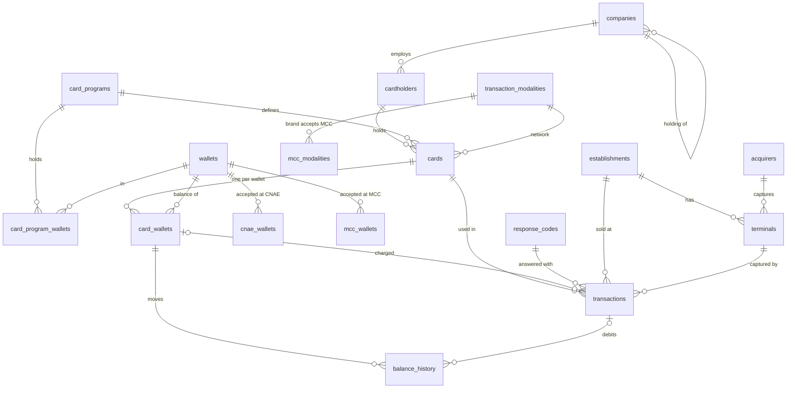

# Data Strategy

Where each table's data comes from. Table and column names are those of `database/oltp_postgres/oltp_schema.sql` ([ADR-006](adr/006-oltp-schema-as-column-contract.md)); the model is explained in [ADR-007](adr/007-transaction-core-model.md) and [ADR-008](adr/008-transaction-record.md).

## Model



## Reference tables — from the config

| Table | Source | Rows |
|---|---|---|
| `wallets` | `pre_populated_data.yaml → wallets` | 8 |
| `card_programs` | `pre_populated_data.yaml → card_programs` | 7 |
| `card_program_wallets` | each program's `wallets` | one row per program × wallet |
| `transaction_modalities` | `pre_populated_data.yaml → transaction_modalities` | 4 (OWN, VISA, MASTERCARD, ELO) |
| `acquirers` | `pre_populated_data.yaml → acquirers` | 7 (six acquirers and the ATM network) |
| `response_codes` | `pre_populated_data.yaml → response_codes` | 16 ISO 8583 codes |
| `cnae_wallets` | `pre_populated_data.yaml → cnae_wallets` | one row per CNAE prefix × wallet |
| `mcc_wallets` | `pre_populated_data.yaml → mcc_wallets` | one row per MCC × wallet (GIFT takes any MCC, no rows) |
| `mcc_modalities` | `validation_rules.yaml → mcc_acceptance_rules` × the public MCC list | one row per MCC × accepting brand |

Loaders: `src/data_generators/reference_data/`. External sources (`src/extractors/`, listed in the README): the IBGE CNAE, localities and population APIs, and the public MCC list. `mcc_acceptance_rules` is synthetic: the brands don't publish their acceptance tables.

## Entity tables — generated

Generated in batches, parents first, by `src/data_generators/entities/`:

```
companies (holdings, then branches)   segment by weight; a branch keeps its holding's
  └── cardholders            as many as the segment says; admission ≥ company registration
        └── cards            one per program of the company's bundle; network from the program
              └── card_wallets   the program wallets the company gives; monthly credit, balance, limits
establishments               category by weight → a CNAE of it → the MCC of that CNAE
  └── terminals              POS/TEF by acquirer weight, e-commerce gateway or ATM by category
```

- Segments and sizes: `simulation_config.yaml → generation_settings.company_segments` — SME 1–250 employees, Middle 251–1,999, Corporate 2,000+, Public by kind of client; `data_volumes.cardholder_scale` generates a share of each headcount.
- Programs: `program_bundles` — what a company contracts.
- Wallets: `wallets` — monthly credit range and limits per wallet; `starting_balance_ratio`.
- Establishments: `establishment_categories` (weight, CNAE prefixes, ticket); `pre_populated_data.yaml → cnae_mcc`.
- Statuses: weights in `generation_settings.*_status_distribution`.
- Dates: ranges in `generation_settings.date_ranges`, relative to a reference day.
- CPF and card numbers are generated valid and stored hashed (`cpf_hash`, `card_number_hash`).
- Reproducible: `src/data_generators/providers/fake.py → seed(n, today=…)` fixes every random source.
- Loading order matters: `companies.parent_id` references `companies`, so holdings go in before branches.

## Transactional tables — simulated

| Table | Content |
|---|---|
| `transactions` | Every attempt (purchase, withdrawal) and its answer: option picked on the terminal, card wallet charged, capture, `pin_status`, `nsu`, ISO `response_code`, `decline_reason`, `authorization_code` when approved; reversals point to their purchase (`related_transaction_id`) |
| `balance_history` | Every balance movement: monthly `credit`, `purchase` and `withdrawal` debits, `reversal` refunds (`src/simulation/balance.py`) |

`TransactionGenerator` (`src/simulation/generator.py`) draws each attempt from `simulation_config.yaml → usage_patterns`. Spending follows the credit: each active wallet of a card makes about *monthly credit × the cardholder's spending ratio ÷ the average ticket where the wallet is used* attempts a month (`spend_profile`: most cardholders spend 80–100%, a tenth are savers; inactive cards and cardholders rarely buy). An attempt takes a wallet by that weight, a kind of place that wallet is used at (now and then any place), a popular shop's terminal, a day weighted by the category's week, the day of month and the calendar (`seasonality`: a weight per month, national holidays taking the category's Saturday, the eve of a holiday, Christmas Eve, New Year's Eve and Black Friday — `src/simulation/seasons.py` — and an intensity each month draws, so months approve between about 85% and 90%), an hour from the category's curve, a log-normal ticket, a capture the terminal and card take, and, on the proprietary network, the option picked on the terminal (now and then the wrong one). In-person purchases happen mostly in the cardholder's city (`local_purchase_ratio`). A share of the employers gives a one-off year-end credit (`simulation.year_end_credit`, a Christmas basket on the FOOD wallet on 10 December), spent over the following month. `FraudGenerator` adds fraud incidents (about 0.5% of the attempts) by scenario — [`fraud-scenarios.md`](fraud-scenarios.md).

`TransactionSimulator` (`src/simulation/simulator.py`) answers them in time order, together with the monthly credits (`benefit_credit_day`) and the reversals it schedules (`simulation.reversal_ratio`). The validators run in `validation_order`; the first failure sets the code and reason; an approval debits the routed wallet and counts toward its daily amount, daily count and monthly amount. A cardholder declined for lack of balance mostly stops trying until the next credit (`give_up_after_insufficient_balance`); a fraudster doesn't. At the end, approved fraud is mostly marked `disputed`, along with a few legit purchases contested by mistake. The ledger holds: each movement starts where the last one ended, no balance goes negative, and `card_wallets.current_balance` is the last movement.

## Pipeline

`python -m src.main setup` (`src/pipeline/`), in one transaction:

1. Create the OLTP schema (idempotent).
2. Upsert the reference tables: running again leaves the same rows.
3. Generate the entities at `simulation_config.yaml → data_volumes` and write them parents first. With entities already in the database it stops unless `--reset`; `--seed` and `--today` fix the result.

The public sources (CNAE, municipalities and population from IBGE, the MCC list) are downloaded once into `data/raw/` (git-ignored). Companies are drawn by municipal GDP (IBGE, [ADR-018](adr/018-company-geography.md)); establishments and the cardholders who don't live in their company's city, by population. The share in the company's city depends on the segment (`company_segments.*.same_city`): 90% for SME down to 35% for Corporate, whose staff is spread across branches.

`python -m src.main simulate` reads the database, simulates `simulation.days` before `--today` (the volume follows the credits: `TransactionGenerator.expected_attempts`) and writes the transactions, the balance movements and the final balances in one transaction. It stops if transactions are already there (start over with `setup --reset`) or if `--today` is before the generated data.

## Analytical model

`python -m src.main etl` (`src/pipeline/etl.py`, [ADR-012](adr/012-olap-plain-sql.md)) stages the OLTP tables in DuckDB and loads the star schema with `database/olap_duck/03_load.sql` — a full refresh into a new file:

| Table | Grain | From |
|---|---|---|
| `dim_*` (10) | one row per wallet, program, network, acquirer, company, cardholder, card, card wallet, establishment, terminal | the OLTP table of the same name; no CPF or card number hashes |
| `dim_card_wallets` | one row per wallet of a card | `card_wallets`; `final_balance` is the balance at the end of the simulation |
| `fact_transactions` | one row per attempt | `transactions`, with the cardholder, company, program, network (`modality_id`), wallet, acquirer and response message joined in |
| `fact_balance_movements` | one row per balance movement | `balance_history`, with the card and wallet |

Views in `04_views.sql`: approval per program and network, declines per code and reason, ticket per category, fraud per scenario, daily volume, wallet flows per month.

## Dataset

`python -m src.main export` (`src/pipeline/export.py`, [ADR-014](adr/014-public-dataset.md)) checks the OLAP database and writes `data/final_datasets/`: one Parquet file per table — the 12 above plus `ref_response_codes`, `ref_program_wallets`, `ref_cnae_wallets`, `ref_mcc_wallets` and `ref_mcc_modalities`, the rules that explain the declines — with `data_dictionary.md` ([copy](data-dictionary.md)) and `quality_report.md`. Any failed check stops it.
