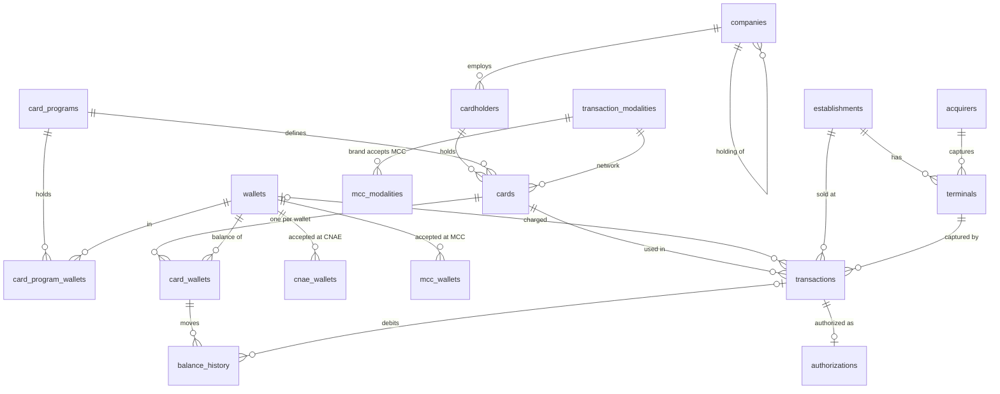

# Data Strategy

Where each table's data comes from. Table and column names are those of `database/oltp_postgres/oltp_schema.sql` ([ADR-006](adr/006-oltp-schema-as-column-contract.md)); the model is explained in [ADR-007](adr/007-transaction-core-model.md).

## Model



## Reference tables — from the config

| Table | Source | Rows |
|---|---|---|
| `wallets` | `pre_populated_data.yaml → wallets` | 8 |
| `card_programs` | `pre_populated_data.yaml → card_programs` | 7 |
| `card_program_wallets` | each program's `wallets` | one row per program × wallet |
| `transaction_modalities` | `pre_populated_data.yaml → transaction_modalities` | 4 (OWN, VISA, MASTERCARD, ELO) |
| `acquirers` | `pre_populated_data.yaml → acquirers` | 6 |
| `cnae_wallets` | `pre_populated_data.yaml → cnae_wallets` | one row per CNAE prefix × wallet |
| `mcc_wallets` | `pre_populated_data.yaml → mcc_wallets` | one row per MCC × wallet (GIFT takes any MCC, no rows) |
| `mcc_modalities` | `validation_rules.yaml → mcc_acceptance_rules` × the public MCC list | one row per MCC × accepting brand |

Loaders: `src/data_generators/reference_data/`. External sources: the IBGE municipalities API, a public MCC list, and the CNAE 2024 dataset on Kaggle (`src/extractors/`).

## Entity tables — generated

Generated in batches, parents first, by `src/data_generators/entities/`:

```
companies (holdings, then branches)
  └── cardholders            admission ≥ company registration
        └── cards            program drawn by weight; network from the program
              └── card_wallets   every wallet of the program; starting balance and limits
establishments               CNAE mostly one that accepts a wallet; category from it
  └── terminals              model and type from the acquirer's list; installation ≥ accreditation
```

- Programs: `simulation_config.yaml → generation_settings.card_program_distribution`.
- Statuses: weights in `generation_settings.*_status_distribution`.
- Balances and limits: `wallet_starting_balance`, `wallet_daily_limit`, `wallet_monthly_limit` (synthetic).
- Dates: ranges in `generation_settings.date_ranges`, relative to a reference day.
- CPF and card numbers are generated valid and stored hashed (`cpf_hash`, `card_number_hash`).
- Reproducible: `src/data_generators/providers/fake.py → seed(n, today=…)` fixes every random source.
- Loading order matters: `companies.parent_id` references `companies`, so holdings go in before branches.

## Transactional tables — simulated (planned, `EP-08`)

| Table | Content |
|---|---|
| `transactions` | Every purchase attempt: wallet charged, capture, `pin_status`, ISO `response_code`, `decline_reason` |
| `authorizations` | The authorization record of each transaction |
| `balance_history` | Wallet movements of approved purchases (`src/processors/balance.py`) |

A transaction picks a card and a terminal. On the proprietary network the cardholder picks one of the card's wallets; on a brand card the issuer routes it by MCC. The validators run in order and the first failure sets the code and reason; an approval debits the wallet.

## Pipeline (planned, `EP-07`)

1. Create the schemas (`src/infrastructure/schema/schema_creator.py` — exists).
2. Load the reference tables.
3. Generate and load the entities, at the volumes in `simulation_config.yaml → data_volumes`.
4. Simulate transactions (`EP-08`).
5. ETL into the DuckDB star schema (`EP-09`), export Parquet (`EP-10`).
